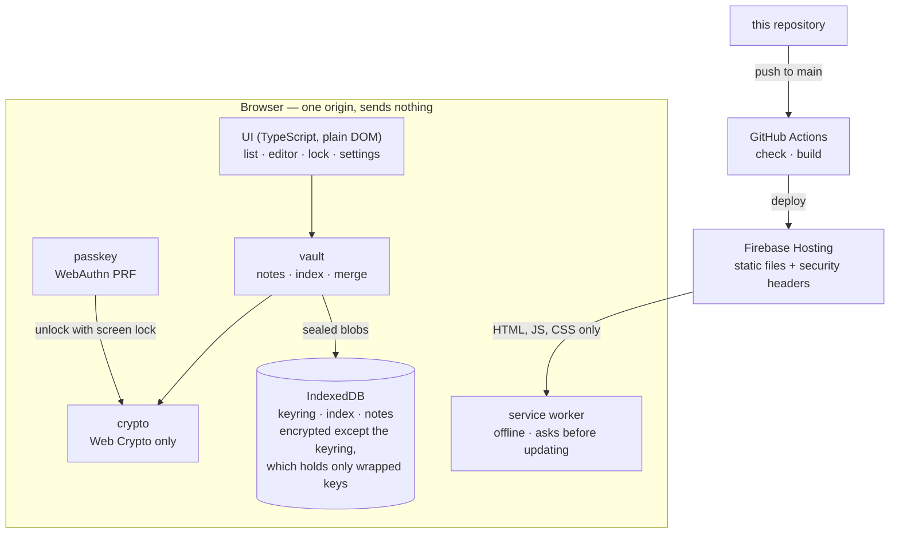

# Tuck Notes

> Private notes that never leave your device unencrypted — a small web app you
> can read end to end.

Tuck Notes is a minimalist Markdown notebook for things you would not write
anywhere else. It runs entirely in the browser as an installable web app (PWA).
Notes are encrypted on your device before they are stored, unlocked with your
device's screen lock through a passkey, and can always be exported and decrypted
**without this app**, using a short script and a passphrase only you know.

**Status:** pre-MVP. See [`docs/plan.md`](docs/plan.md).

## Tenets

1. **Simple.** One list, one editor, one lock. Every feature has to justify the
   code it adds, because every line is a line someone has to audit.
2. **Verifiable.** The code is public, small, and built only on standard web
   APIs. There are no runtime dependencies to trust. The storage and encryption
   formats are written down in [`docs/format.md`](docs/format.md) precisely
   enough to decrypt your notes without us.
3. **Yours.** Nothing is sent anywhere. Nothing is readable until you unlock it.
   You can take everything out, at any time, in a form that outlives the app.

## How your notes are protected

- **Everything is encrypted at rest** with AES-256-GCM, using the browser's
  built-in [Web Crypto API](https://developer.mozilla.org/en-US/docs/Web/API/SubtleCrypto).
  That includes titles, timestamps, and settings — not just note bodies. Before
  you unlock, the only things visible are that encrypted data exists, roughly
  how much, and how many notes there are.
- **One random 256-bit master key** encrypts the vault. It is never stored
  unencrypted and never leaves the browser's crypto engine once unlocked.
- **Two ways to unlock it**, each holding its own wrapped copy of the master
  key:
  - **Your passkey**, for everyday use. Unlocking is your device's own screen
    lock prompt. The passkey's [PRF extension](https://w3c.github.io/webauthn/#prf-extension)
    derives a key only after that check passes. Passkeys sync through iCloud
    Keychain or Google Password Manager, so your other devices can unlock the
    same vault.
  - **Your passphrase**, for recovery and for decrypting exports outside the
    app. It is stretched with PBKDF2-SHA-256 (600,000 iterations). Keep it in a
    password manager; it is the one secret that, if lost along with your
    passkey, makes your notes unrecoverable by anyone.
- **The app locks itself** after a few idle minutes (configurable) and whenever
  it is hidden — switching tabs or apps, or turning your phone's screen off.
  Edits are saved continuously, and saved before locking.
- **The browser enforces that the app cannot phone home.** Pages are served
  with a Content Security Policy that forbids every outbound network
  connection.

### Threat model

| Threat                                              | Protected? |
| --------------------------------------------------- | ---------- |
| Someone who copies your browser's storage           | Yes        |
| A lost or stolen device that is locked              | Yes        |
| Forensic examination of the disk                    | Yes        |
| A network attacker                                  | Yes (HTTPS, and the app sends nothing) |
| A future sync server reading your notes             | Yes (it would only ever hold encrypted blobs) |
| Malware or a person using your unlocked device      | No         |
| Someone who can pass your device's screen lock      | No — it is what unlocks the passkey |
| The app's host serving malicious code               | No — see below |

**What you are trusting.** A web app's code is delivered by its host every time
it updates, so you are trusting the host and HTTPS the way you trust any website
— here, the maintainer, who runs it from this public repository. To make changes
visible rather than silent, the installed app shows which commit it is running,
and **asks before updating**, showing which commit it would update to. That
makes updates transparent; it does not make a malicious host impossible.
Reproducible builds that let you verify the deployed bundle are on the
[ideas list](docs/ideas.md).

**Browser storage can be wiped.** Clearing site data deletes your notes, and
Safari deletes data from sites you haven't visited in a while unless the app is
installed to your home screen. Install the app, and export regularly.

## Getting your notes out

**Export** downloads a single file, `tuck-export.json`, holding your encrypted
notes exactly as stored, plus everything needed to unlock them with your
passphrase. Nothing in it is readable without that passphrase.

**Import** restores an export into a fresh browser, or merges it into the same
vault on another device (the newer copy of each note wins). It unlocks with the
passkey if that device has it, or the passphrase if not.

**Decrypt it yourself** with [`tuck-decrypt.mjs`](https://tuck.apps.theantes.family/tuck-decrypt.mjs),
a dependency-free script that runs on [Node.js](https://nodejs.org/) 20 or
newer. It reads the passphrase from standard input, so it never appears on
screen or in your shell history:

```console
read -rs PASS && printf '%s' "$PASS" | node tuck-decrypt.mjs tuck-export.json notes/
unset PASS
```

…or straight from your password manager's CLI:

```console
op read "op://Private/Tuck Notes/password" | node tuck-decrypt.mjs tuck-export.json notes/
```

You get one `Note Title.md` file per note. The script is built from the same
decryption code the app uses, and [`docs/format.md`](docs/format.md) describes
every byte, so you could write your own in any language.

## Architecture



- **No runtime dependencies.** The shipped app uses only browser APIs: Web
  Crypto, WebAuthn, IndexedDB, service workers, and the DOM. No framework.
- **TypeScript, built with [Bun](https://bun.sh/).** The bundle is not minified,
  so the code your browser runs reads like the code in this repo.
- **Notes are the source of truth.** Each note is its own encrypted blob,
  containing everything about it. A separate encrypted index caches titles
  and timestamps so the list loads quickly; it can always be rebuilt from the
  notes. A note's body is decrypted only when you open it.
- **Markdown is edited as raw text and never rendered to HTML**, so a note can
  never inject code into the page.
- **Hosting is static.** [Firebase Hosting](https://firebase.google.com/docs/hosting)
  serves the built files and the security headers. The app does not use any
  Firebase SDK.

## Development

```console
bun install          # dev tooling only — the app has no runtime dependencies
bun run dev          # build and serve locally
bun test             # unit tests
bun run check        # typecheck, lint, format check
bun run build        # → dist/
```

Pushing to `main` deploys to <https://tuck.apps.theantes.family/> through
GitHub Actions.

## Layout

- `src/crypto/` — encryption, key derivation, the keyring, passphrase policy.
- `src/vault/` — notes, the index, storage, import merging.
- `src/passkey/` — WebAuthn PRF unlock.
- `src/export/` — export and import files, and the `tuck-decrypt.mjs` entry
  point.
- `src/app/` — the UI.
- `src/pwa/` — the service worker and update prompt.
- `docs/format.md` — the storage and encryption specification.
- `docs/plan.md` — the road to the MVP.
- `docs/ideas.md` — the backlog.

## License

[AGPL-3.0](LICENSE). If you run a modified version for others, you must share
its source — which, for an app like this, is the point.
