# Storage and encryption format

The contract for everything Tuck Notes writes: what is in the browser's storage,
what is in an export, and how to decrypt it. It is written so that someone could
recover their notes **without this app or this repository's code** — the
`tuck-decrypt.mjs` script is one implementation of this document, not the
definition of it.

This is format **version 1**. Draft until the MVP ships; after that, any change
to the bytes below gets a new version number and the old one stays readable
forever.

## Primitives

Everything uses the browser's Web Crypto API. Nothing else.

| Purpose                   | Algorithm                                               |
| ------------------------- | ------------------------------------------------------- |
| Encryption                | AES-256-GCM, 96-bit random IV, 128-bit tag              |
| Passphrase → key          | PBKDF2-HMAC-SHA-256, 600,000 iterations, 128-bit salt   |
| Passkey output → key      | HKDF-SHA-256, empty salt                                |
| Passkey output            | WebAuthn PRF extension, 256-bit salt                    |
| Randomness                | `crypto.getRandomValues`, `crypto.randomUUID`           |

Conventions used below:

- **Base64** is standard, padded base64 (RFC 4648 §4).
- **Times** are ISO 8601 strings in UTC, e.g. `2026-10-29T18:04:11.532Z`.
- **UTF-8(x)** is the UTF-8 encoding of string `x`.
- **Labels inside the format** — associated data, the HKDF `info`, the
  database name, the export's `format` field — never contain the product's
  name, so the app can be renamed without a format change. They don't need to
  be globally unique: each vault has its own random master key, so one app's
  blobs can never open under another's.
- **`‖`** is byte concatenation.

## The key hierarchy

```mermaid
flowchart LR
  passkey["passkey"] -- "PRF(prfSalt)" --> hkdf["HKDF-SHA-256"] --> kek1["KEK"]
  passphrase["passphrase"] -- "NFC, UTF-8" --> pbkdf2["PBKDF2-SHA-256"] --> kek2["KEK"]
  kek1 -- "unwraps" --> master["master key"]
  kek2 -- "unwraps" --> master
  master -- "encrypts" --> blobs["index + notes"]
```



The **master key** is 32 random bytes, generated once per vault. Every copy of
the vault — on every device, and in every export — uses the same master key, so
moving encrypted blobs between devices never requires re-encrypting them.

Each **key-encryption key (KEK)** is derived from one unlock method and is used
only to encrypt ("wrap") the master key.

## Sealed blobs

Every encrypted thing — a note, the index, a wrapped key — is a **sealed blob**:

```text
offset  length  contents
0       1       format version: 0x01
1       12      IV, random, unique to this blob
13      n       AES-256-GCM ciphertext
13+n    16      GCM authentication tag
```

To open one: take the version byte, choose the associated data (below) for that
version, and AES-GCM-decrypt bytes `13…end` with the IV at `1…13`. (Web Crypto
and most libraries take ciphertext and tag together, in that order.) If the tag
does not verify, the blob was corrupted, tampered with, or belongs somewhere
else — **stop**; never use a partial result.

**Associated data** binds each blob to where it belongs, so a blob moved into
another slot fails to decrypt instead of decrypting as the wrong thing:

| Blob                     | Associated data                                       |
| ------------------------ | ----------------------------------------------------- |
| Note with id `<id>`      | `UTF-8("notes/v1/note/<id>")`                    |
| The index                | `UTF-8("notes/v1/index")`                        |
| Passphrase-wrapped key   | `UTF-8("notes/v1/key/passphrase")`               |
| Passkey-wrapped key      | `UTF-8("notes/v1/key/passkey/<credentialId>")` where `<credentialId>` is its base64 |

### Padding

Note and index plaintexts are JSON, padded with ASCII spaces (`0x20`) to the
next power of two, with a minimum of 1024 bytes, before encryption. JSON ignores
trailing whitespace, so a reader simply parses the decrypted bytes; there is no
unpadding step. Padding hides each note's exact size: an observer learns only
which power of two it falls under.

Wrapped keys are not padded; they are always 32 bytes.

## The keyring

The only unencrypted record. It contains no secrets — salts, parameters, and
wrapped copies of the master key — and is stored and exported as JSON:

```json
{
  "version": 1,
  "vaultId": "0f8c2a9e-…",
  "passphrase": {
    "kdf": "PBKDF2-SHA-256",
    "iterations": 600000,
    "salt": "<base64, 16 bytes>",
    "wrappedKey": "<base64 sealed blob>"
  },
  "passkey": {
    "credentialId": "<base64>",
    "prfSalt": "<base64, 32 bytes>",
    "wrappedKey": "<base64 sealed blob>"
  }
}
```

- **`vaultId`** is a random UUID identifying the vault, so import can tell "the
  same vault from another device" from "a different vault".
- **`passkey`** is absent when the vault was set up on a device whose passkeys
  cannot do PRF. A device without access to the passkey unlocks with the
  passphrase.

### Unwrapping with the passphrase

1. Normalize the passphrase to Unicode NFC and encode it as UTF-8. (The same
   accented character can be typed as different code points on different
   systems; NFC makes them one.)
2. KEK = PBKDF2-HMAC-SHA-256(passphrase, `salt`, `iterations`, 32 bytes).
3. Master key = open `passphrase.wrappedKey` with the KEK.

### Unwrapping with a passkey

1. Call `navigator.credentials.get` for `credentialId` with
   `userVerification: "required"` and the PRF extension evaluating `prfSalt`.
   The relying party ID is `tuck.apps.theantes.family`.
2. KEK = HKDF-SHA-256(input = the 32-byte PRF result, salt = empty,
   info = `UTF-8("notes/v1/kek/passkey")`, 32 bytes).
3. Master key = open `passkey.wrappedKey` with the KEK.

This path cannot be reproduced outside a browser with access to the passkey,
which is why every vault always has a passphrase.

## Notes

Each note is one sealed blob, keyed by its id, a random UUID. Decrypted:

```json
{
  "id": "5b1e…",
  "created": "2026-10-29T18:04:11.532Z",
  "updated": "2026-10-29T18:09:47.020Z",
  "title": "Groceries",
  "body": "- eggs\n- milk\n- …",
  "trashed": "2026-10-30T08:00:00.000Z"
}
```

A note is self-contained: the index is never needed to recover it.

**`trashed`** is present only while the note is in the Trash, and records when
it was put there. It lives in the note rather than only in the index, because
the note is the source of truth: a rebuilt index must not quietly pull a
trashed note back into the list.

**`title` and `body` are independent.** `title` is optional: a note without one
has no `title` property at all. The app never writes an empty or
whitespace-only title — clearing the title field removes the property. The body
is free-form text: nothing in the format or the app reads structure or meaning
from it, and it may begin however it likes.

### Display title

Wherever a note has to be named — the note list, and the files
`tuck-decrypt.mjs` writes — it uses its **display title**:

1. `title`, if the note has one;
2. otherwise, `Note from ` followed by its `created` time in local time.

The body is never consulted, so the list can name every note from the index
alone and never decrypts a note the user didn't open. The display title is
computed when it is shown and never stored.

The app formats the time for the reader's locale (`Note from Oct 29, 2026,
6:04 PM`). `tuck-decrypt.mjs` writes it as `YYYY-MM-DD HH.MM`
(`Note from 2026-10-29 18.04`), which sorts by date in a file listing and
avoids `:`, which several file systems forbid.

### The Trash

Deleting a note is two steps, as in a desktop recycle bin:

1. **Move to Trash** sets `trashed` and `updated` to now. The note leaves the
   main list and appears in the Trash. **Restore** removes `trashed` and sets
   `updated` to now. Both rewrite the note's blob and its index entry in one
   transaction.
2. **Delete Permanently** (one note) or **Empty Trash** (every trashed note)
   removes each note's blob and its entry in the index, in one transaction.
   Nothing about the note is kept — no record that it existed.

Trashing and restoring set `updated` because they are changes like any edit:
that is what lets them carry across devices on import, under the same
"later `updated` wins" rule. A restored note therefore moves to the top of the
list.

"Permanently" means the app can no longer read the note. Browser storage
engines may leave the deleted blob's bytes on disk until they compact; those
bytes are still encrypted under the vault's master key.

## The index

One sealed blob holding what the app needs to list notes without decrypting
them, plus the few records that belong to the vault rather than to any one
note. Decrypted:

```json
{
  "notes": {
    "5b1e…": {
      "title": "Groceries",
      "created": "…",
      "updated": "…",
      "trashed": "…"
    }
  },
  "settings": { "lockAfterMinutes": 5 }
}
```

- **`notes`** is a cache of each note's `title`, `created`, `updated`, and
  `trashed`, each absent when the note lacks it. Nothing from a note's body is
  ever copied into the index. If the index is lost or damaged, this part is
  rebuilt by decrypting the notes.
- **`settings`** live here, encrypted, rather than in plain browser storage.

`settings` cannot be rebuilt from the notes. If the index is lost, settings
reset to their defaults; the notes themselves are unaffected.

## Browser storage

One IndexedDB database, `vault`, with two object stores:

| Store   | Key         | Value                          |
| ------- | ----------- | ------------------------------ |
| `vault` | `"keyring"` | the keyring, as a JSON string  |
| `vault` | `"index"`   | the index, a sealed blob       |
| `notes` | note id     | the note, a sealed blob        |

A note and the index are always written in the same transaction, so they can
never disagree. Nothing is written to `localStorage`, `sessionStorage`, cookies,
or the Cache API except the app's own code.

## The export file

`tuck-export.json`:

```json
{
  "format": "notes-export",
  "version": 1,
  "keyring": { "…": "exactly as above" },
  "index": "<base64 sealed blob>",
  "notes": {
    "5b1e…": "<base64 sealed blob>"
  }
}
```

The blobs are the stored bytes, unchanged. The file deliberately records no
export time.

### Decrypting an export by hand

1. Unwrap the master key from `keyring.passphrase`, as above.
2. For each entry in `notes`, base64-decode it and open it with the master key,
   using the associated data for that note id.
3. Parse the plaintext as JSON. The note's title is `title` (absent if it has
   none) and its Markdown is `body`.

### What `tuck-decrypt.mjs` writes

One file per note, named after its display title, made safe for every common
file system: characters in `/ \ : * ? " < > |` and control characters become
`-`, leading dots and trailing dots or spaces are removed, the name is cut to
200 characters, and a clash gets ` (2)`, ` (3)`, … appended. Each file's
contents are the note's body, unchanged. Notes in the Trash are written like
any other.

The script reads the passphrase from standard input, removes **one** trailing
`\n` or `\r\n` (so password-manager CLIs and `echo` both work), and refuses to
run if standard input is a terminal, so a passphrase is never typed visibly.

## Importing

- **Into an empty browser:** the export's keyring is adopted as-is — same vault
  id, same master key, same wrapped copies — and its blobs are stored
  unchanged. It unlocks with the keyring's passkey if this device has it, or
  with the passphrase.
- **Into the same vault** (matching `vaultId`): for each note id, the copy with
  the later `updated` wins, and a note only the export has is added. Since
  permanent deletion leaves no record, importing an export made before a note
  was deleted brings that note back, in whatever state the export had it.
  Blobs are copied unchanged.
- **Into a different vault:** refused in version 1.

Every imported blob is decrypted and checked before anything is written; an
import either completes entirely or changes nothing.

## Passphrase policy

A passphrase is accepted when its estimated strength is at least **100 bits**,
computed as `length × log2(pool)`, where `pool` sums 26 for any lowercase
letter, 26 for any uppercase letter, 10 for any digit, 33 for any ASCII symbol
or space, and 100 for anything else. Before measuring, runs of a repeated
character count once, and a passphrase that is a shorter string repeated is
measured as that shorter string.

This estimate assumes the characters were chosen at random. It is a guard
against short and lazy passphrases, not a proof of strength: a phrase of
common words scores far above its real strength. The guidance is to let a
password manager generate the passphrase, or to use at least eight random
words.
